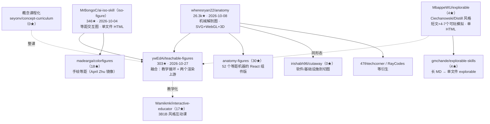

# 复加调研：从 teachable-figures 挖出的「可交互教学图」子生态

> 起点：[ywEdAi/teachable-figures](https://github.com/ywEdAi/teachable-figures)（303★，
> 2026-10-27 创建）——把课文断言变成「预测→操作→解释」实验的 agent skill。
> 本报告回答两个问题：**为什么前两轮没搜到？** 以及 **顺着它还能挖出什么？**

## 0. 结论速览

| 问题 | 答案 |
|---|---|
| 为什么漏检 | 三个原因叠加：①303★ 排在第一轮 `teachable skill agent` 检索第 10 名（367★）之后，被 per_page=10 截断；②它的自我描述词汇（causal teaching figures / predict, try, explain / misconception / explorable）与前两轮词表（teachable / education / tutor / animation）零重叠；③仓龄仅 2 周、无 topics 标签，GitHub search 的相关度排序也不抬它 |
| 滚雪球发现了什么 | 它 README 自述**融合了两个上游 skill**：wheresryan22/anatomy（26.3k★）与 MrBongoC/ai-iso-skill（346★）。顺着这条引用链 + 新词表（isometric / explorable / cutaway / predict-observe-explain），挖出 **15+ 个此前全部漏检的项目**，构成完整的「可交互教学图」子生态 |
| 方法论修正 | Top-N 检索后必须做一轮**引用滚雪球**：读 top 项目的「融合声明 / upstream / credits / inspired-by」段（teachable-figures 的 `references/sources-and-fusion.md` 就是完整范本）；词表要包含目标项目的**自述动词**（predict / try / explain），不是只有领域名词 |
| 对 innate 的价值 | 这个子生态正好补上 [visual-explain-research](./visual-explain-research.md) 的 L3（explorable 单页）能力层：predict→try→explain 教学循环 + 学习科学 checklist + 单文件 HTML 交付，是 innate-daily 教程可视化的直接可抄结构 |

## 1. 漏检复盘：Top-N 检索的三个盲区

```text
盲区一：星数截断           per_page=10 + sort=stars → 第 11 名起全部不可见
                           （teachable-figures 303★ vs 第 10 名 367★，差一步）
盲区二：词汇体系偏差       它说 "predict, try, explain" "causal teaching figures"
                           我搜 "teachable" "education" "tutor" "animation"
                           → 零交集。它的词来自学习科学（misconception/scaffolding），
                           不是软件分类词
盲区三：新仓无信号         2026-10-27 创建、无 topics、star 增长中——
                           GitHub 相关度排序和 star 排序都不抬新仓
```

**修正后的检索配方**（已回填 [feeds-topic-search.md](./feeds-topic-search.md) §3.5）：

1. Top-N 之后**必做引用滚雪球**：读榜单项目的 fusion/upstream/credits/inspired-by；
2. 词表加**自述动词**（predict / try / explain / observe）与**产出形态词**
   （isometric / cutaway / exploded / explorable / single-file HTML）；
3. 对「星数 <500 但仓龄 <1 月」的项目单独过一遍（新兴子生态的早期项目都长这样）。

## 2. teachable-figures 本体分析（303★，2026-10-27）

### 2.1 它是什么

> Turn a lesson's claim into an experiment a learner can operate.
> Predict a result, change a cause, read the effect, and explain a new case.

- **教学循环**：预测 → 操作 → 观察 → 解释（对准一个可被推翻的错误预期 misconception）；
- **受众分叉**：教师/家长演示（大图少文、课堂预测提示、可切换的 focus guide）vs
  自学者（前知探测、针对误解的反馈、支架渐撤、迁移练习）——**受众改变构建**；
- **学习者工作区**：项目内 `teachable-figures/` 三份 MD（LESSONS / LEARNER / LEARNING-PLAN），
  agent 每课先读后更新——**跨会话学习者画像**，与 oil-ui 工作区、AgentHandover 同一思想；
- **学习科学落地**：每个 spec 过一遍 checklist（认知负荷/支架渐撤/注意信号/双重编码/
  误解定向反馈，引 Sweller、Mayer、Paivio、Wood/Bruner/Ross、Kalyuga、Chi）；
- **边界诚实**：明示「这是教学设计，未经学习者实测」；拒绝数据图表/幻灯片/整门课程。

### 2.2 机制与渲染分离（最值得抄的结构）

```text
kind（教什么）≠ renderer（怎么画）
  kind 词表：sampler / tokens / attention / threshold / flow / agent / builder…
  renderer：2D SVG / 等距 SVG / 机械 SVG / 转动 3D / 按需 WebGL
"A gear ratio does not need a 3D renderer to teach the ratio."
```

15 个成品例子（齿轮比/贝叶斯/四季/月相/四冲程/Transformer 数据流/信息熵/价格上限…）
在线可玩：ywedai.github.io/teachable-figures；含**盲测记录**（BLIND-TESTS 公开错误）。
验收是真浏览器检查（Playwright，21 个 browser cases + reduced-motion + 360px 布局）。

## 3. 滚雪球：挖出的完整谱系

### 3.1 谱系图



### 3.2 复加项目清单（15 个，前两轮全部漏检）

| 项目 | 星数 | 仓龄/活跃 | 一句话定位 | 与 teachable-figures 关系 |
|---|---|---|---|---|
| [wheresryan22/anatomy](https://github.com/wheresryan22/anatomy) | **26.3k** | 10-08 / 🟡 | 「把概念建造成真实工作的物件」：等距机械图，SVG+WebGL shader+3D，自检（逐关节放大检查） | **直接上游**（渲染层） |
| [MrBongoC/ai-iso-skill](https://github.com/MrBongoC/ai-iso-skill)（iso-figure） | 346 | 10-04 / ⚪ | 面局部 SVG 矩阵、功能键/开关/显示器，单文件 HTML | **直接上游**（等距层） |
| [wheresryan22/anatomy-figures](https://github.com/wheresryan22/anatomy-figures) | 30 | 10-09 / ⚪ | 52 个 Anatomy 图变成 live React 组件/自定义元素 | 上游的组件化 |
| [MbappeWU/explorable](https://github.com/MbappeWU/explorable) | 4 | 09-26 / ⚪ | 「问 agent 任何东西怎么运作，得到一页可玩的」：短文+4-7个真模拟（非动画），agent 先在真浏览器玩过再交付；有公开盲测错误记录 | 同形态平行项目 |
| [Wamikmk/interactive-educator](https://github.com/Wamikmk/interactive-educator) | 17 | 06-26 / ⚪ | 3B1B 风格**互动课程**（非视频） | 教学化变体 |
| [madearga/colorfigures](https://github.com/madearga/colorfigures) | 18 | 10-20 / 🟢 | 手绘墨线风等距交互物件（April Zhu skill 镜像+新例） | iso-figure 风格衍生 |
| [orchimada/technical-explanatory-minimalism](https://github.com/orchimada/technical-explanatory-minimalism) | 2 | 06-14 / ⚪ | 极简技术图解+可探索解释：规则+已验证交互例 | 审美约束极值 |
| [gmchande/explorable-skills](https://github.com/gmchande/explorable-skills) | 4 | 05-08 / ⚪ | 长 Markdown 文档 → 单文件 HTML explorable | 文档转化入口 |
| [seyonv/concept-curriculum](https://github.com/seyonv/concept-curriculum) | 0 | 09-21 / ⚪ | 一个主题 → 整门可视课程：讲解卡+贯穿例子+实测数字+画廊索引+验收门 | 整课化（上游边界之外） |
| [mikeroySoft/codebase-atlas](https://github.com/mikeroySoft/codebase-atlas) | 5 | 09-02 / ⚪ | 代码库 → 交互式等距架构图（单 HTML，file:line 引用） | 面向软件的理解图 |
| [irishabh96/cutaway](https://github.com/irishabh96/cutaway) | 0 | 10-21 / 🟢 | 软件/agent/基础设施的交互剖切图（SVG/WebGL/3D） | anatomy 衍生 |
| [aruneshvv/edu-by-llm](https://github.com/aruneshvv/edu-by-llm) | 1 | 08-11 / ⚪ | 任意主题 → 等距交互模拟（自包含 HTML 学习体验） | 教育向轻量版 |
| [oh-namgyu/cc-anatomy](https://github.com/oh-namgyu/cc-anatomy) | 0 | 10-21 / ⚪ | Claude Code 自身运行机制的交互分步模拟（每步引官方文档） | 元应用：用形态解释 agent |
| [baney75/myelinate](https://github.com/baney75/myelinate) | 6 | 11-08 / 🟢 | 苏格拉底导师 14 技能套件（辅导/作业/考试/复习/闪卡/计划），「诚实不顺从」 | 教学法侧近亲 |
| [Lunamos/paper2video](https://github.com/Lunamos/paper2video) + [sepi2p/research-explainer-skill](https://github.com/sepi2p/research-explainer-skill) | 10/9 | 🟢 | 论文 → 3B1B 风格解说视频（Remotion，断言核查+真实数据图） | 学术解释管线 |

### 3.3 子生态的结构规律

1. **谱系分明**：anatomy（渲染工艺）与 iso-figure（等距装置）是两个上游，
   teachable-figures 在其上叠**教学循环**——分层融合而非重造（其
   `sources-and-fusion.md` 记录了确切 commit、license、融合决策与「改了什么」清单，
   是 skill 融合的规范文档）。
2. **形态收敛于单文件 HTML**：离线可用、无框架、无远程资源——与
   issue #9 可执行教程的「点击即本地运行」结论一致。
3. **验收都在真浏览器**：anatomy 自检（放大每个关节）、teachable-figures
   （21 browser cases）、explorable（agent 自己先玩一遍）——三个头部项目同一标准。
4. **学习科学是这个子生态的差异化词汇**：misconception / scaffolding / fading /
   cognitive load / dual coding——这些词在普通前端 skill 里不出现，
   也是检索词表偏差的根源。
5. **星数与质量在此生态脱钩**：anatomy 26k★ 但 io/图解类衍生多在 0-30★——
   **「可视化理解」是需求巨大、供给早期**的洼地。

## 4. 修正后的完整图景：EDU 可视化三层

把本报告并入前两轮 Top 20 后，「教育 × 可视化」的完整分层：

```text
层三：教学循环层（最稀缺）   teachable-figures（predict→try→explain + 学习科学
                             checklist + 学习者工作区）、interactive-educator、
                             myelinate（苏格拉底 14 技能）
层二：解释形态层（爆发中）   anatomy / iso-figure / explorable / cutaway /
                             colorfigures / concept-curriculum / codebase-atlas
层一：渲染产能层（红海）     Manim 系 / Remotion 系 / GSAP / hyperframes
                             （= edu-animation-skills-top20 的主榜单）
```

**判断**：层一已经官方化、工业化；层二正在快速裂变（2026-09 后新仓密集）；
**层三几乎只有 teachable-figures 一个成熟样本**——edu 与「教会」之间最大的一块空地。

## 5. 对 innate 的追加建议

1. **innate-daily 的 L3（explorable 单页）直接采用 teachable-figures 结构**：
   - 教学循环（预测→操作→观察→解释）作为组件交互的最小骨架；
   - `kind`/renderer 分离的词表（innate 场景：sampler/tokens/attention/threshold
     正好覆盖前端与 AI 概念教程）；
   - 单文件 HTML 交付 + 真浏览器验收（与本仓 driver.mjs 冒烟管线天然衔接）。
2. **skills-kit 若做「fe-figure」技能**，融合文档直接抄
   teachable-figures 的 `sources-and-fusion.md` 结构（provenance 表 + 实现覆盖表 +
   融合改动清单 + license 处理四段式）。
3. **edu-animate 域词表扩充**（feeds 侧）：加入 `predict-observe-explain` /
   `teachable figure` / `isometric` / `cutaway` / `explorable` 关键词与
   本报告 §3.2 的 15 个候选仓。
4. **innate-fe-examples 增加一个「teachable figure」参考实现**：
   用 React 复刻一个最小 predict→try→explain 组件（如 CSS 盒模型/事件循环的
   可交互解释页），作为 edu 尝试与可视图 explain 的交汇样板。

## 6. 方法论沉淀（回填检索报告的修正）

| 修正 | 内容 |
|---|---|
| 滚雪球必做 | Top-N 之后读榜单项目的 upstream/fusion/credits 段；fusion 文档是最准的谱系地图 |
| 词表三层 | 领域名词（education）+ 自述动词（predict/try/explain）+ 产出形态词（isometric/explorable/single-file） |
| 新仓单独过 | 星数 <500 且仓龄 <1 月的项目单独人工过一遍——子生态早期都长这样 |
| 平行形态检索 | 同形态不同词的项目（explorable vs teachable-figures）互为发现入口 |

## 7. 参考链接

- teachable-figures：<https://github.com/ywEdAi/teachable-figures>（15 例在线：
  <https://ywedai.github.io/teachable-figures/>）
- teachable-figures 融合文档：<https://github.com/ywEdAi/teachable-figures/blob/main/references/sources-and-fusion.md>
- anatomy：<https://github.com/wheresryan22/anatomy>
- iso-figure：<https://github.com/MrBongoC/ai-iso-skill>
- explorable：<https://github.com/MbappeWU/explorable>（画廊：
  <https://mbappewu.github.io/explorable/>）
- interactive-educator：<https://github.com/Wamikmk/interactive-educator>
