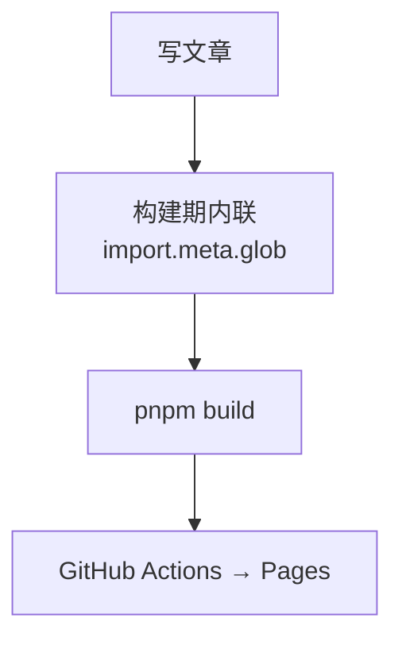
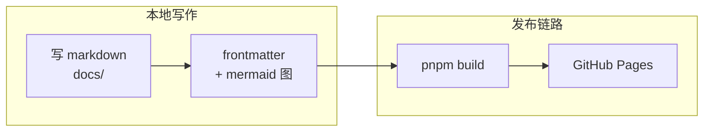
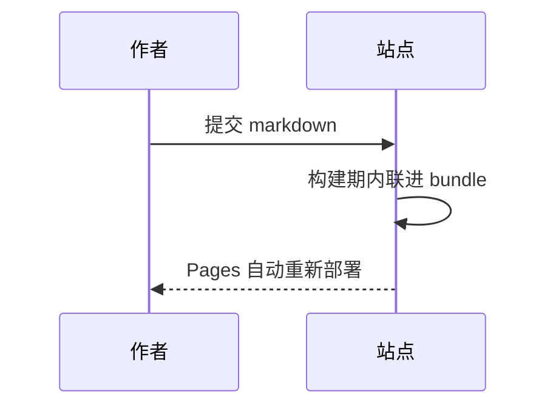

# Markdown 写作指南：基本用法与图表

> 这份文档把散落在各处的「在本仓怎么写 Markdown」整合成一篇：**文件放哪**、
> **frontmatter 字段**、**基本语法**、**mermaid 图表**（流程图 / 路程图 / 时序图等）。
> 规则来自站点的实际实现（`src/lib/content/`、`src/components/markdown-preview.tsx`），
> 不是泛泛的 Markdown 教程。

## 1. 文章放哪：目录即展区

站点在**构建期**用 `import.meta.glob` 把 `docs/**/*.md(x)` 内联进 bundle
（运行时无 fs、无网络请求），所以新文章只要落进 `docs/` 就会被收录。
**目录结构本身就是分区**：`docs/` 第一层目录 = 展区（胶囊筛选、首页
画廊都按它聚合），frontmatter 里的 `category` 不再作为分组维度，只留作参考。

| 位置 | 展区 | 用途 |
| --------------------- | --------- | ---------------------------------------- |
| `docs/ideas/**` | `ideas` | 想法与方案草稿 |
| `docs/research/**` | `research` | 调研报告 |
| `docs/tutorials/**` | `tutorials` | 教程（basic 等子目录可继续分层） |
| `docs/use-cases/**` | `use-cases` | 用例系列（own-your-daily 五篇等） |

两条纪律：

1. **`status` 必须是 `published` 才会出现在面向访客的列表里**；
   `draft` 的文章在写作台可见（带 Draft 徽标），但不进正式列表。
2. **本地图片不会进 bundle**。构建期只内联 markdown 文本，图片要么用
   外链 URL，要么放进 `public/docs-media/`（见 §3.5）。

开发时可以用 `VITE_WRITING_SOURCE` 只加载一棵子树，加快启动与构建：

```bash
pnpm dev              # 全部 docs/**（默认）
pnpm dev:docs         # 仅 tutorials / research / ideas 展区
pnpm dev:use-cases    # 仅 use-cases 展区
```

## 2. Frontmatter 字段

每篇文章以 YAML frontmatter 开头（`---` 包裹的键值块）。站点解析器
（`src/lib/content/parser.ts`）支持这些字段：

| 字段          | 必填 | 说明                                                                 |
| ------------- | ---- | -------------------------------------------------------------------- |
| `title`       | 建议 | 文章标题；缺省时取正文第一个 `#` 标题，再退回文件名                   |
| `slug`        | 建议 | URL 标识；缺省时按 `vault-目录-文件名` 自动生成                       |
| `date`        | 建议 | 发布日期（`YYYY-MM-DD`），列表按它倒序；缺省取构建时刻                |
| `updated`     | 可选 | 最后更新日期                                                          |
| `author`      | 可选 | 作者；缺省 `Anonymous`                                                |
| `category`    | 可选 | **仅留作参考**——分组以目录推导为准                                    |
| `tags`        | 可选 | 标签数组；`label` / `labels` 是它的别名，三者会合并去重               |
| `excerpt`     | 可选 | 摘要；缺省时自动取正文第一段（剥掉标题与代码块、截断过长段落）        |
| `cover`       | 可选 | 封面图 URL                                                            |
| `featured`    | 可选 | 布尔； Plaza 卡片墙加 ✦ 徽标                                          |
| `editorsPick` | 可选 | 布尔；编辑推荐                                                        |
| `readingTime` | 可选 | 阅读时长（分钟）；缺省按正文字数估算                                  |
| `status`      | 建议 | `published`（默认）/ `draft` / `archived`，只有 published 会展示      |

一个可直接抄的模板：

```markdown
---
title: "文章标题"
slug: my-article
date: 2026-11-07
author: Innate Team
category: guide
tags: [tag-a, tag-b]
status: published
excerpt: "一句话摘要，列表页与卡片墙会展示它。"
---

# 文章标题

正文从标题下开始……
```

## 3. 基本用法

渲染管线是 react-markdown + remark-gfm + rehype-highlight + rehype-slug，
即 **GitHub 风味 Markdown（GFM）全量支持 + 代码高亮 + 标题锚点**。

### 3.1 标题与目录

- 正文的一级标题（`# `）缺省时还会被当作文章标题；
- 所有标题自动生成锚点 id，文章页右侧目录（TOC）由标题层级自动提取，
  不需要在正文里手写目录；
- 标记方式就是行首井号加空格：`##` 开头是二级标题（TOC 一级条目）、
  `###` 开头是三级标题（TOC 二级条目）。
  **注意**：目录提取按行扫描、不感知代码围栏——不要在代码块里放以
  `##` 开头的示例行，否则会被误收进 TOC（本文 §3.1 就特意用行内代码写语法）。

### 3.2 强调、列表与引用

```markdown
**粗体**、*斜体*、~~删除线~~、`行内代码`

- 无序列表
1. 有序列表

- [ ] 任务列表（GFM）
- [x] 已完成项

> 引用块：适合放「边界」「注意」这类旁注。
```

### 3.3 表格（GFM）

| 语法      | 效果             |
| --------- | ---------------- |
| \`a \| b\` | 表头分隔的两列   |
| `:---`    | 左对齐           |
| `:---:`   | 居中             |

表格单元格里可以用行内代码和粗体，但不能换行——需要换行的内容拆成多行列表放在表格下方。

### 3.4 代码块与高亮

用三反引号围栏 + 语言标注，rehype-highlight 会做语法高亮
（未知语言不会报错，退化为纯文本）：

````markdown
```ts
export function hello(name: string): string {
  return `hello, ${name}`
}
```
````

### 3.5 链接与图片

```markdown
[站内文字链接](https://example.com)
<https://example.com>          ← GFM 自动链接
 ← 方式一：外链 URL
 ← 方式二：public/docs-media/ 下的相对路径
```

图片两条路：

1. **外链 URL**——最省事，图床 / GitHub raw 都可以；
2. **仓库内图片**——把图片放进 `public/docs-media/`，Markdown 里写
   相对路径 `docs-media/图片名`。`public/` 会在构建时原样拷进产物根目录，
   哈希路由下相对路径正好解析到站点根（本地 dev 与 GitHub Pages 都成立）。
   不要写 `/` 开头的绝对路径——站点部署在仓库子路径上，绝对路径会 404；
   也不要把图片放 `docs/` 里——构建期只内联 Markdown 文本，目录里的
   图片文件不会被带上。

下面就是方式二的实拍（本仓库 `public/docs-media/sample-cover.webp`）：


## 4. 图表：mermaid（流程图 / 路程图 / 时序图……）

``` ```mermaid 围栏块会被单独交给 mermaid 渲染成图（`MermaidBlock`），
配色从 CSS token 读取，**跟随站点亮 / 暗主题**，不是 mermaid 默认配色。

### 4.1 支持的图型

围栏第一行以下列图型开头即被识别为 mermaid 图
（识别逻辑在 `src/lib/content/mdx-source.ts`）：

`flowchart` / `graph`、`sequenceDiagram`、`classDiagram`、
`stateDiagram-v2`、`erDiagram`、`journey`、`gantt`、`pie`、`gitGraph`、
`mindmap`、`timeline`、`quadrantChart`、`sankey-beta`、`xychart-beta`、
`block-beta`、`packet-beta`、`kanban`、`architecture-beta`、`c4Context`。

### 4.2 流程图（flowchart）：最基本的图

````markdown

````

渲染效果（本页即可看到）：


- `TD` 自上而下、`LR` 自左而右；节点文字里有特殊字符（中文冒号、括号、
  竖线）时用 `["…"]` 引号包起来，换行用 `<br/>`。

### 4.3 路程图：带分组的流程图（subgraph）

把「本地」与「CI」两条路线画在一张图里，是本文最常见的画法：



- `subgraph ID["显示名"] … end` 把节点圈成一组；
- 跨组的连线（`P --> B`）直接写在 subgraph 之外。

### 4.4 时序图（sequenceDiagram）



### 4.5 注意事项

- mermaid 运行在 `securityLevel: "strict"` 下：图表里的 HTML 标签、
  可点击链接会被转义，别在图表里依赖交互；
- 图表源码也会参与目录树 / 摘要提取之外的所有正文处理——图表上方若紧贴
  普通文字，识别逻辑会自动从第一行图型关键字开始截取，一般无需担心；
- 旧式 MDX 写法 `<MermaidBlock chart={\`…\`} />` 仍被兼容
  （构建期会被规范化成 mermaid 围栏），但**新文章一律直接写围栏块**。

## 5. 写完之后

内容是**构建期内联**的，改完 markdown 需要重新构建才能进产物：

```bash
pnpm dev        # 开发期：vite dev 会随文件变动重新内联，:4016 预览
pnpm build      # 产物：dist/（+ 404.html 兜底）
pnpm preview    # 本地预览 dist
```

提交推送后，GitHub Actions 会自动重新构建并部署到
<https://variableway.github.io/innate-daily/>。
