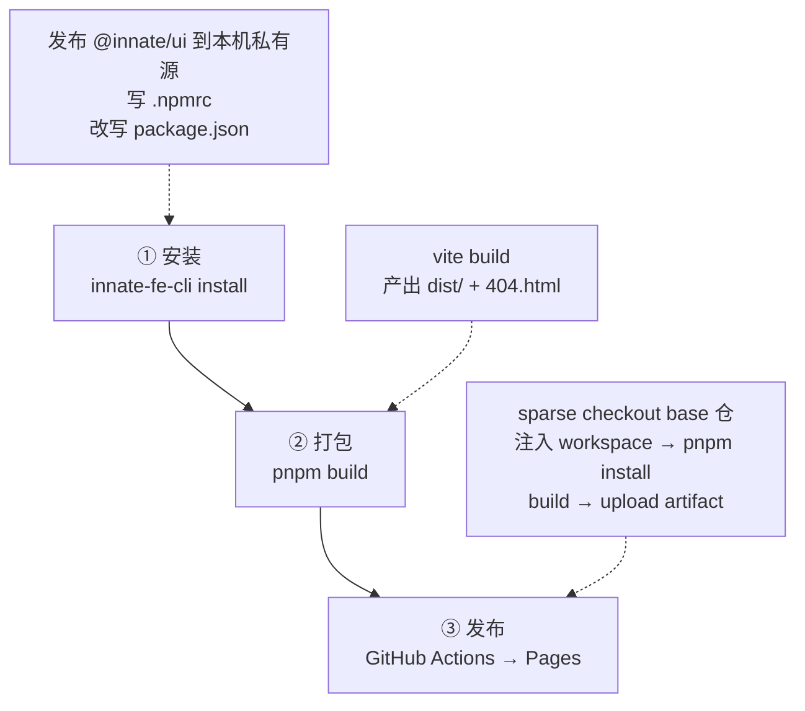
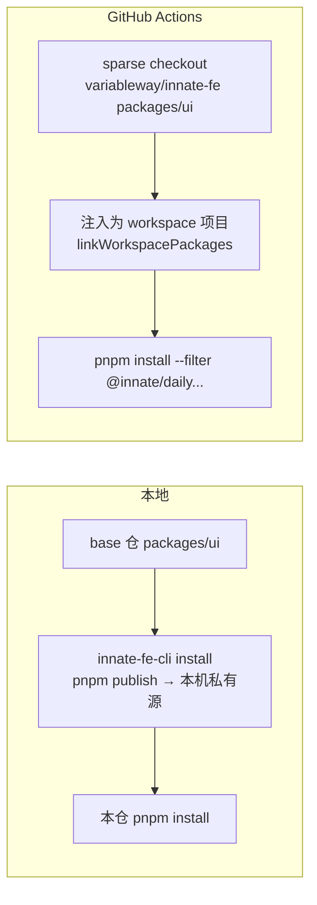

# daily-work 构建指南 - 5 分钟搭建篇

> 这份文档回答四个问题：**想构建什么**、**现在构建成什么样**、**日常怎么更新**、**整条构建流程长什么样**。
> 技术细节（仓库布局、CLI 命令、CI 原理、错误对照）全部压在最后的附录里，需要时再翻。

## 1. 想要构建什么

一句话：**用 innate-fe 提供的公共包，按自己的需求拼一个能独立构建、独立部署的内容站。**

daily-work（`@innate/daily`）就是这个站的第一版实例，它由三层组成：

| 层            | 是什么                                                                 | 在哪                                |
| ------------- | ---------------------------------------------------------------------- | --------------------------------- |
| **公共包层**  | UI 组件、CLI 等可复用能力（`@innate/ui`、`innate-fe-cli` …）            | base 仓 `variableway/innate-fe`   |
| **站点层**    | Vite + React 19 + TanStack Router（hash 路由）的写作工作台               | 本仓 `src/`                       |
| **内容层**    | Markdown / MDX，在**构建期**内联进 bundle（运行时无 fs、无网络请求）      | 本仓 `content/`、`use-cases/`      |

最终产物是一个**纯静态站**：`vite build` 产出 `dist/`（附带 `404.html` 兜底），托管在 GitHub Pages
——<https://variableway.github.io/innate-daily/>。

站点跑起来之后能做什么：

- `/writing` 三栏写作台：左侧目录树 / 分类标签筛选，中间文章列表，右侧正文预览（可拖拽、可折叠）；
- `/collections` 收藏集：收藏外部站点的三栏浏览页（与 `/writing` 同构）；
- `/landing` 首页：内容策展入口。

## 2. 构建成什么样了

截至 2026-10-22，三条线都跑通且全绿：

| 环节       | 状态    | 产物 / 地址                                      |
| ---------- | ------- | ------------------------------------------------ |
| 本地开发   | ✅ 稳定  | `pnpm dev` → <http://localhost:4016>              |
| 本地构建   | ✅ 稳定  | `pnpm build` → `dist/` + `404.html`              |
| CI 部署    | ✅ 全绿  | push `main` → GitHub Actions → GitHub Pages      |

站点当前的内容规模：`content/` 9 篇（`demo/` 3 篇演示 + `research/ui/` 6 篇调研），
`use-cases/build-it-own/` 1 篇（就是这份构建指南）。

依赖侧的状态：**`@innate/ui` 在本地和 CI 上走两条不同的路**——本地从本机私有源装，CI 上直接链接
base 仓 workspace 里的 `packages/ui`。这不是配置漂移，而是刻意设计，流程图里会画出来。

> **边界**：多 domain **组合安装**（一次把多个站点模板装齐）目前还没有落到实际形态，
> 本文不写这一段；等它有确定的形态和命令之后再补一节。

## 3. 如何进行更新

日常只有三类改动，各自的路径是固定的：

| 改什么            | 在哪改                            | 本地怎么生效                          | 怎么发布                                  |
| ----------------- | --------------------------------- | ------------------------------------- | ----------------------------------------- |
| **内容**（md/mdx） | `content/`、`use-cases/`         | 刷新页面（构建期内联，需重新构建）      | 提交 → CI 自动重新部署                    |
| **站点代码**       | `src/`                            | `pnpm dev` 热更新                      | 提交 → CI 自动重新部署                    |
| **公共包**         | base 仓 `packages/ui` 等          | `innate-fe-cli install --bump patch`  | 提交本仓改写后的版本号 → CI 重新部署      |

三条纪律：

1. **改公共包必须升版本**。同版本号在 registry 里已存在时，发布会被跳过，装到的还是旧包——
   所以改完 `packages/ui` 一律 `--bump patch`。
2. **`link:` 协议的临时改动不要提交**。它是应急手段，机器相关，提交上去会让 CI 和协作者挂。
3. **本地私源相关文件是可以提交的**（`package.json` 里的 `^0.1.0`、`.npmrc`、`pnpm-lock.yaml`），
   因为 CI 不走私有源，走 workspace 链接，不依赖这些文件的私有源配置。

发布后到 <https://variableway.github.io/innate-daily/> 看效果；CI 每次跑完都会在
Actions 页给出构建与部署两个 job 的结果。

## 4. 这个构建流程

整条链路就三段：**安装 → 打包 → 发布**。



### 4.1 安装：把公共包装进本仓

```bash
cd /d/innate-workspace/apps/daily-work

innate-fe-cli install --dry-run    # 先看计划：发布顺序 / .npmrc / 改写计划
innate-fe-cli install              # 实跑；首次会自动拉起本机私有源
innate-fe-cli install --dev        # 装完直接起 dev（:4016）
```

这一条命令背后是四件事：

1. **定位 base 仓**（`--root` > `INNATE_FE_ROOT` > `.innate-fe-cli.json` > 自动发现）；
2. **发布**：把 base 仓 `packages/` 下可发布的 `@innate/*` 按拓扑序发布到本机私有源；
3. **写 `.npmrc`**：把 `@innate` scope 指到本机私有源；
4. **改写 `package.json`**：`"@innate/ui": "workspace:*"` → `"^0.1.0"`，然后 `pnpm install`
   一次性装齐 `@innate/ui` **及其全部传递依赖**。这一步很关键：`@innate/ui` 是 TS 源码包，
   它自己的依赖（clsx / cva / tailwind-merge / @base-ui/react …）必须由包管理器一并装上，
   手工补符号链接补不齐（对应 A.5 里的 `Cannot find module '@innate/ui'`）。

### 4.2 打包：把站点编译成静态产物

```bash
pnpm build     # vite build + 复制 dist/index.html → dist/404.html
pnpm preview   # 本地预览产物
```

`PUBLIC_PATH=./` 让所有资源走相对路径，产物就能丢到任意子路径下托管，不用为每个仓库改 base。

### 4.3 发布：交给 GitHub Actions

push 到 `main` 后，`deploy-pages.yml` 依次做：checkout 本仓 → sparse checkout base 仓的
`packages/ui` 等文件 → 把本仓注入成 workspace 项目 → `pnpm install --filter @innate/daily...`
→ build → upload artifact → deploy 到 GitHub Pages。

### 4.4 本地与 CI：`@innate/ui` 的两条路

这是整套流程里唯一"看起来不一致"的地方，原因是**私有源只在本机存在**：



CI 上没有本机的私有源，所以直接把 base 仓的 `packages/ui` 链接过来用；
细节（为什么必须写在 workspace 根的 `pnpm-workspace.yaml` 里）见附录 A.3。

## 5. 包与仓库：公用包、私有仓库、GitHub 仓库、管理方式

### 5.1 公用包（npm 公开源，装上就能用）

站点的大部分依赖都是公开发布的普通包，装的时候不需要任何特殊配置：
`react` / `react-dom`、`vite`、`@vitejs/plugin-react`、`tailwindcss`、`mermaid`、
`@tanstack/react-router`、`lucide-react`、`react-markdown` + `remark-gfm` / `rehype-highlight` /
`rehype-slug`、`@fontsource-variable/inter` / `@fontsource-variable/jetbrains-mono`。

### 5.2 私有仓库（本机 Verdaccio，装 `@innate/*`）

base 仓内置了一套本机私有源（`innate-fe-cli registry setup/start/publish/init`），
状态目录在 `<base 仓>/.verdaccio/`。它的作用很单一但很关键：

> 把 base 仓的 `packages/` 发布成**本机可安装的包**，让独立仓能装到 `@innate/ui`，
> 并顺带装齐它自己的传递依赖。

同版本已存在会跳过；想强制重发就 `--bump patch`。

### 5.3 远端私有（GitHub Packages，备用方案）

需要团队共享时，可以把 `@innate/*` 发到 `npm.pkg.github.com`，机器无关、CI 可用、版本可追溯。

一个坑：GitHub Packages 要求包名 scope 等于 owner，而 `innate` 这个名字已被占用。
不需要改包名——CLI 的 `--publish-as` 会在**发布时**临时把 `@innate/*` 改写成 `@variableway/*`
（连同内部依赖引用与 `workspace:` 协议一起展开），发完自动还原 `package.json`，git 无痕。

```bash
# 发布侧
export NPM_TOKEN="<你的 GitHub PAT>"   # scopes: write:packages（源仓库私有再加 repo）
innate-fe-cli registry publish --url https://npm.pkg.github.com --publish-as @variableway --token "$NPM_TOKEN"

# 安装侧（token scopes: read:packages）
innate-fe-cli install --url https://npm.pkg.github.com --publish-as @variableway
```

> 切过去之后，源码里的 `import ... from "@innate/ui"` 也要跟着改成 `@variableway/ui`（install 不会改源码）。

### 5.4 GitHub 仓库（都有谁）

| 仓库                                        | 角色                                                          |
| ------------------------------------------- | ------------------------------------------------------------- |
| `variableway/innate-fe`                    | base 仓：框架 + 公共包（`@innate/*`）+ `innate-fe-cli` 源码   |
| `variableway/innate-daily`                 | **本仓**：站点代码与内容，独立 git 仓，CI 直出 Pages          |
| `variableway/innate-fe-templates` 的 release | `pages-kit`：预构建的壳 `writing-shell.zip`（`pages pack` 用） |

### 5.5 管理方式

- **一条命令管住"发布 → 配置 → 改写 → 安装"**：`innate-fe-cli install`，不手动拼四条命令；
- **版本号是唯一的真相**：`--bump patch` 升版再发；同版本跳过，避免"改了但没生效"；
- **registry 有自己的生命周期**：`innate-fe-cli registry status` / `registry stop`；
- **base 仓的命令要在 base 仓里跑**（或加 `--root`）：`gen` / `dev` / `build` / `registry` 等；
  本仓内直接可用的只有 `pages`；
- **CI 不依赖私有源**，所以本机私有源挂了也不影响部署。

---

## 附录：技术细节

### A.1 仓库布局（本机现状）

```
D:\innate-workspace\
├─ framework\innate-fe\            ← base 仓（GitHub: variableway/innate-fe）
│  ├─ plugins.registry.yaml        ← base 仓标记（CLI 根探测目标，注意是复数）
│  ├─ innate-fe-cli\               ← CLI 源码（bun 项目，零 npm 运行时依赖）
│  ├─ bin\innate-fe-cli.exe        ← 编译出的 binary
│  ├─ packages\ui\                 ← @innate/ui（本仓需要的 UI 包）
│  └─ shells\webshell\             ← 壳
└─ apps\daily-work\                ← 本仓（GitHub: variableway/innate-daily），独立 git 仓库
   ├─ plugin.registry.yaml         ← 文稿仓标记（单数，protocol: innate.domain-pages.v1）
   ├─ package.json                 ← @innate/daily，依赖 "@innate/ui": "^0.1.0"
   ├─ .npmrc                       ← @innate:registry=http://127.0.0.1:4873/
   └─ use-cases\build-it-own\      ← 本文所在位置
```

全局命令 `innate-fe-cli` 实际是 `C:\Users\anyda\.local\bin\innate-fe-cli`，即
`framework\innate-fe\bin\innate-fe-cli.exe` 的拷贝。

### A.2 `innate-fe-cli` 速查（daily-work 视角）

| 需求                                     | 命令                                          | 在哪跑                              |
| ---------------------------------------- | --------------------------------------------- | ----------------------------------- |
| 一键装依赖（发布 + 配置 + 改写 + 安装）   | `innate-fe-cli install`（`--dev` 装完起 dev）   | 本仓根                              |
| 一键流程预览                             | `innate-fe-cli install --dry-run`             | 本仓根                              |
| 只装不发布                               | `innate-fe-cli install --no-publish`          | 本仓根                              |
| 改完公共包升版重发                       | `innate-fe-cli install --bump patch`          | 本仓根                              |
| 出静态站（零 npm 依赖，用预构建壳）       | `innate-fe-cli pages pack`                    | 本仓内任意目录                      |
| base 仓命令（gen/dev/build/registry…）   | 先 `cd` 到 base 仓，或加 `--root <base 仓>`   | base 仓                             |
| 私有源状态 / 停止                        | `innate-fe-cli registry status` / `stop`      | base 仓或 `--root`                 |
| 重编 CLI binary                          | base 仓根 `pnpm run cli:build` → 拷到 `~/.local/bin` | base 仓                    |

### A.3 CI 部署细节

`deploy-pages.yml` 的关键动作：

1. **sparse checkout** base 仓的 `packages/ui`、`packages/tsconfig`、`package.json`、
   `pnpm-workspace.yaml`、`pnpm-lock.yaml`；
2. **注入**：把本仓挪到 `templates/apps/daily-work`，从而成为 base workspace 的一个 project；
3. **安装**：`pnpm install --filter @innate/daily... --no-frozen-lockfile`
   （base 仓 lockfile 里没有这个注入项目的 importer，所以必须放行 frozen-lockfile）；
4. **构建**：`PUBLIC_PATH=./ pnpm --filter @innate/daily build`；
5. **发布**：upload artifact → deploy 到 GitHub Pages。

第 2 步带来一个副作用：pnpm 只读 **workspace 根**的设置，站点自己的 `.npmrc` 和
`pnpm-workspace.yaml` 都不生效（`@innate` scope 也就不会指向本机私有源）。
所以 workflow 会在 workspace 根追加两行：

```bash
printf '\nlinkWorkspacePackages: true\npreferWorkspacePackages: true\n' >> pnpm-workspace.yaml
```

让 `@innate/ui@^0.1.0` 链接到 sparse checkout 出来的 `packages/ui`，而不是去 npm 找一个
从未发布的包（那会 404）。实测：pnpm 12 下 `--config.prefer-workspace-packages=true`
和 `npm_config_*` 环境变量都**无效**，只有写在 workspace 根的 `pnpm-workspace.yaml` 里才生效。

CI 的触发路径是 `use-cases/**`、`docs/**`、`src/**`、`index.html`、`package.json`、
`vite.config.ts` 与 workflow 自身。

### A.4 Collections 模块速查

数据只有一份：[`src/data/collections.json`](https://github.com/variableway/innate-daily/blob/main/src/data/collections.json)。加一条收藏就是往
`collections` 数组里加一个对象，字段约束由 `src/test/collections.test.ts` 校验：

| 字段            | 要求                    | 说明                                                   |
| --------------- | ----------------------- | ------------------------------------------------------ |
| `id`            | 必填、全文件唯一        | kebab-case                                            |
| `title` / `description` / `url` | 必填非空     | `url` 作为 iframe `src` 与"新窗口打开"链接            |
| `source`        | `kimi` \| `feishu` \| `other` | 徽标颜色由 `label-chip` 按名字哈希自动生成        |
| `category`      | 必填非空                | 自由文本，筛选栏按去重值自动生成选项                    |
| `tags`          | 可空数组                | 英文小写为佳，按出现频次排序                            |
| `date`          | `YYYY-MM-DD`            | 列表按它倒序                                            |
| `featured`      | 可选布尔                | 卡片加 ✦ 徽标，筛选栏有 Featured 独立开关               |

页面行为：路由 `/#/collections`，筛选状态落在 URL（`?source=&category=&tag=&featured=`），
刷新 / 分享不丢；宽屏三栏可拖拽，中屏侧栏收进 Sheet，窄屏列表 / 查看器双态切换。
部分站点不允许 iframe 嵌入，查看器会显示"cannot be embedded"并给新窗口入口——这是预期行为。

代码地图：`data/collections.json`（唯一需日常维护的文件）、`lib/collections/{types,data}.ts`、
`components/collections/{collections-page-client,collections-list,collection-viewer}.tsx`、
`pages/collections/page.tsx`。

### A.5 常见错误对照表

| 报错                                                          | 原因                                             | 处理                                                                    |
| ------------------------------------------------------------- | ------------------------------------------------ | ----------------------------------------------------------------------- |
| 找不到仓库根（向上未找到 `plugins.registry.yaml`）             | 在 base 仓外跑了 base 类命令                      | `cd` 到 base 仓，或加 `--root`                                          |
| 找不到 innate-fe 基础仓（install）                             | 四种定位方式都没命中                             | `--root` / `INNATE_FE_ROOT` / `.innate-fe-cli.json` 任选其一配置        |
| 找不到文稿仓（向上未找到 `plugin.registry.yaml`）              | `pages` 在非文稿仓目录运行                        | `cd` 到 daily-work                                                      |
| 下载 `writing-shell.zip` 需要 `FE_TEMPLATES_TOKEN` 或 `GH_TOKEN` | release 下载缺 token                          | `export GH_TOKEN="$(gh auth token)"`                                   |
| `workspace` 协议解析失败 / `ERR_PNPM_WORKSPACE_OPTION_NOT_SET` | 独立仓里用了 `workspace:*`                        | `innate-fe-cli install`，或改 `link:` / registry 版本号                  |
| `Cannot find module '@innate/ui'`（或 `/globals.css`）         | `node_modules` 里的断链 symlink                   | `rm -rf node_modules` 后跑 `innate-fe-cli install`                     |
| `409 Conflict "this package is already present"`              | 重复发布 registry 上已存在的版本                   | 重跑 `innate-fe-cli install` 会自动跳过；要发新版加 `--bump patch`      |
| `401 / EAUTH` 发布或安装失败                                  | PAT 缺对应 scope，或 `.npmrc` 没配 token          | 核对发布侧 `write:packages` / 安装侧 `read:packages`                   |
| CI 报 `@innate/ui` 404                                         | workspace 根没开 workspace 链接                   | 确认 workflow 里追加 `linkWorkspacePackages` 的两行还在                 |

### A.6 本仓命令

```bash
pnpm dev            # vite dev（:4016）
pnpm build          # vite build + 404 兜底 → dist/
pnpm preview        # 预览 dist
pnpm typecheck      # tsc --noEmit
pnpm lint           # oxlint src
pnpm test           # vitest run
```
