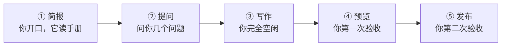

# 搭工具：让 Agent 替你动手，在这个网站发出第一篇文章

大约二十分钟后，一篇署着你名字的文章会出现在
<https://variableway.github.io/innate-daily/> ——可以被搜索到，手机能打开，
可以转发给朋友。

你不需要看懂任何代码。过程中屏幕上会滚过很多代码——把它们当天气就行：
你不需要懂气象学，也能决定要不要带伞。

## 开工前，你只需要三样东西

1. **一个 AI 编程助手**（Claude Code、Codex、Cursor……任意一个，装在你电脑上）
2. **这个仓库的写权限**——找管理员把你加进来，一次性的事
3. **一篇你真的想发的东西**——一段观察、一篇读后感、一次记录，500 字就够

## 它会走的路，先给你看一眼



五个站，你只出手两次。

## ① 简报：你开口，它读手册

对 AI 助手说下面这段话（整段复制，把最后两行的括号内容换成你的）：

```text
我要在这个仓库（innate-daily）发一篇文章。
动手之前，先完整读一遍 docs/markdown-usage.md，那是这个站的写作规范，
之后所有动作都要符合它，尤其是 frontmatter 字段和图片规则。
我的文章主题是：（你写什么，比如：我家楼下面馆的观察）
我的署名是：（你的名字）
```

这里会出现一堆你没见过的词。只需要记住一件事：第一段话让助手**先去读规范再干活**——
就像实习生入职先读员工手册。这样规则由仓库里的文档来解释，你不用自己当解说员。

## ② 提问：唯一需要你的环节

它会反过来问你几个问题：文章放在哪个目录、想叫什么标题。照实回答就行，
拿不定主意就说"你按规范推荐一个"。

## ③ 写作：你完全空闲

它会新建一个文件（名字类似 `docs/use-cases/xxxx.md`），文件开头长这样：

```markdown
---
title: "你起的标题"
author: "你的名字"
status: published
---
```

> **这几行是什么？** 文章的身份证：标题、作者、状态。`published` 的意思是
> "对外可见"。就这些。

**这一站你要盯一件事：** 这个任务从头到尾应该**只新增一个文件**。
如果它开始修改别的文件，停下来问它："你在改什么？为什么？"
一个靠谱的助手会解释清楚；解释不清楚的改动，不要批准。

## ④ 预览：第一次验收

跟它说"起本地预览"。它会在终端里跑一条命令，然后告诉你一个地址——
在浏览器打开 `http://localhost:4016`。

**你要做的：** 找到你的文章，点进去，检查三样——标题对不对、段落顺不顺、
图片显不显示。

> **最容易翻车的地方：** 图片显示不出来。这个站只认网络图片链接，
> 你电脑里的图片路径是不行的。发现了就让助手"把图片换成可访问的外链"。

## ⑤ 发布：第二次验收

跟它说"发布"。它会把文章提交并推送上去，之后网站会在几分钟内自动重新构建。

**你要做的：** 等 Pages 部署完成（助手会告诉你怎么确认，通常是看仓库的
Actions 页面变绿），然后用**手机浏览器**打开正式网址，看到你的文章——毕业。

三个最常见的卡点，先给你防身：

| 现象 | 多半是 | 对助手说 |
|------|--------|----------|
| 推送被拒绝 | 你还没有仓库权限 | "提示没权限，帮我看看怎么回事" |
| Actions 变红 | 文章格式不合规范 | "看下构建日志哪里报错，修好再推" |
| 网址看不到新文章 | 缓存 / 还没部署完 | 等 2 分钟强刷，还不行再查 |

## 你刚刚做完了什么

你没有写一行代码，但你刚走完一个完整的软件项目：需求（你想发什么）、
规范（站点怎么写）、实现（助手建文件）、预览（本地验收）、上线（正式网址）。

屏幕上滚过的那些词，现在每个都对应你亲眼见过的一件事：

- **Markdown** —— 你文章的格式，纯文本，所以放在哪都能活
- **Frontmatter** —— 文件开头那几行身份证
- **构建** —— 网站把你的文章"装订"进网页的过程
- **部署** —— 装订好的网页被放到正式网址上

想再深入一点点（不看也完全没关系）：[Golang CLI 入门](golang-cli-101.md)
和 [Node + TypeScript 入门](nodejs-typescript-101.md) 讲的就是帮你干活的
助手背后的工具是怎么造出来的。

## 附录：懒人版一句话指令

上面五步可以压缩成一句话发给助手，适合"我就想看看行不行"的人：

```text
读 docs/markdown-usage.md 了解发文规范，然后一步步带我在这个仓库
发出我的第一篇文章：先问我主题和署名，写好后起本地预览让我确认，
我确认后再提交推送。每一步开始前，用一句人话告诉我你要干什么。
```

最后那句"用一句人话告诉我你要干什么"，是你跟任何 AI 助手合作时
最值钱的一句话。
